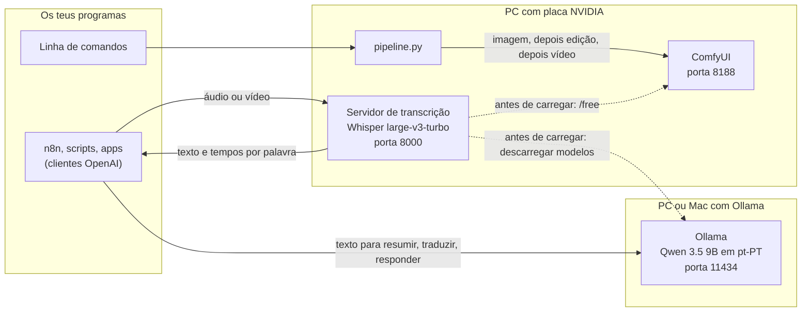

# KCU IA Local

> **Isto é uma ideia, não um produto.** É a forma como nós corremos IA no nosso próprio PC, sem nuvem e sem mensalidades. Está aqui de graça para quem quiser pegar e adaptar ao seu. Sem suporte e sem garantias.
>
> *This is an idea, not a product: how we run AI on our own machines, free for anyone to take and adapt. No support, no warranty. (Docs in Portuguese.)*

Três peças de IA local que usamos todos os dias, já sem nada nosso lá dentro:

1. **[Transcrição](transcricao/)**: um servidor com a mesma API da OpenAI que transcreve áudio e vídeo com o Whisper large-v3-turbo, com tempos por palavra. Antes de carregar, liberta a placa gráfica (pede ao ComfyUI e ao Ollama para largarem os modelos).
2. **[Ollama em pt-PT](ollama/)**: um Modelfile que põe o Qwen 3.5 9B a responder sempre em **português de Portugal**.
3. **[Pipeline ComfyUI](comfyui-pipeline/)**: imagem (Z-Image Turbo) → edição com a mesma personagem (Qwen-Image-Edit 2511) → vídeo (Wan 2.2), tudo pela linha de comandos.

## Como encaixa



As três peças são independentes: podes usar só uma. Quando estão na mesma máquina, o servidor de transcrição trata de não as pôr a lutar pela memória da placa.

---

## 1. Transcrição local

Servidor FastAPI com o [faster-whisper](https://github.com/SYSTRAN/faster-whisper) e o modelo **Whisper large-v3-turbo**. Fala a mesma língua que a API da OpenAI: qualquer cliente que aceite outro endereço base funciona sem mudanças.

**O que faz**

- `POST /v1/audio/transcriptions` aceita áudio **ou vídeo** (qualquer coisa que o ffmpeg leia, MP4 incluído).
- Respostas em `json`, `text`, `srt`, `vtt` ou `verbose_json`. Com `timestamp_granularities[]=word` devolve cada palavra com início e fim (legendas palavra a palavra, cortes automáticos).
- Carrega o modelo só no primeiro pedido e tira-o da placa ao fim de 5 minutos parado, para a GPU ficar livre para jogos e outros trabalhos.
- Antes de carregar, se faltar memória na placa: espera que o ComfyUI acabe o trabalho em curso (nunca o interrompe), descarrega os modelos do Ollama e pede ao ComfyUI para libertar a memória.
- `GET /v1/gpu` mostra a memória livre e quem a está a usar; `POST /v1/gpu/libertar` liberta tudo antes de um trabalho pesado.
- Chave de API opcional (`Authorization: Bearer ...`).

**Requisitos**

- Python 3.10 ou mais recente e [ffmpeg](https://ffmpeg.org) no PATH.
- Placa NVIDIA com **cerca de 4 GB de VRAM livres** (o modelo turbo em `float16` usa ~3,5 GB). Um ficheiro de 20 minutos transcreve-se em menos de meio minuto numa placa recente.
- Sem placa NVIDIA também corre, no CPU (`TRANSCRICAO_DISPOSITIVO=cpu`, `TRANSCRICAO_PRECISAO=int8`), mas bem mais devagar.

**Instalar e correr**

```powershell
cd transcricao
python -m venv .venv
.venv\Scripts\pip install -r requirements.txt
.\iniciar.ps1
```

No Linux/macOS: `python3 -m venv .venv && .venv/bin/pip install -r requirements.txt && ./iniciar.sh`.

O modelo (~1,6 GB) descarrega-se sozinho do Hugging Face no primeiro pedido. Para testar: `.venv\Scripts\python testar.py gravacao.mp3 --palavras`.

Para arrancar com o Windows, cria uma tarefa agendada "ao iniciar sessão" que corre `powershell -ExecutionPolicy Bypass -File <pasta>\transcricao\iniciar.ps1`.

**Definições que importam**

| Variável | Padrão | Nota |
|---|---|---|
| `TRANSCRICAO_HOST` | `127.0.0.1` | Para usar noutro aparelho, `0.0.0.0` **com** `TRANSCRICAO_API_KEY`, e só dentro de uma VPN ou rede privada. |
| `TRANSCRICAO_IDIOMA` | *(deteta)* | `pt` evita que um áudio curto seja detetado como espanhol. |
| `TRANSCRICAO_IDLE_SEGUNDOS` | `300` | Quanto tempo o modelo fica na placa sem uso. |
| `TRANSCRICAO_COMFY_URL` / `TRANSCRICAO_OLLAMA_URL` | locais | Quem libertar antes de carregar. Se não existirem, são ignorados. |

A lista completa está em [transcricao/README.md](transcricao/README.md).

---

## 2. Ollama: Qwen em português de Portugal

Os modelos pequenos tendem a escorregar para o português do Brasil. Este [Modelfile](ollama/Modelfile) junta ao **Qwen 3.5 9B** uma instrução de sistema que obriga a responder em pt-PT, com vocabulário de cá, e os parâmetros de amostragem recomendados para o modelo.

**Requisitos**: [Ollama](https://ollama.com) recente; **7–8 GB** de VRAM livre (ou um Mac com Apple Silicon e 16 GB de memória).

```sh
cd ollama
ollama pull qwen3.5:9b
ollama create qwen-pt -f Modelfile
ollama run qwen-pt "What is a GPU?"
```

Para usar a partir de clientes OpenAI: endereço `http://127.0.0.1:11434/v1`, modelo `qwen-pt`. Mais em [ollama/README.md](ollama/README.md).

---

## 3. Pipeline ComfyUI

Um script de linha de comandos que manda fluxos ao teu [ComfyUI](https://github.com/comfyanonymous/ComfyUI) pela API e descarrega os resultados:

| Passo | Modelo | Resultado | Tempo típico* |
|---|---|---|---|
| `imagem` | Z-Image Turbo, 8 passos | Imagem de partida (personagem, cenário) | ~5 s por imagem |
| `editar` | Qwen-Image-Edit 2511 + LoRA Lightning 4 passos | A mesma personagem numa cena nova, 720x1280 | ~30 s |
| `video` | Wan 2.2 I2V 14B fp8 (high + low noise) + LoRA lightx2v 4 passos | Clip de 5 s a 16 fps; com `--fim`, primeira e última imagem | 2–5 min |
| `ultimo-fotograma` | ffmpeg | PNG do fim do clip, para encadear o plano seguinte | — |
| `suavizar` | ffmpeg (minterpolate) | Clip a 32 fps e 1080x1920 | ~1 min |

\* Numa placa NVIDIA de gama alta; varia muito com a placa e a resolução.

**Requisitos**

- ComfyUI recente (os nós `TextEncodeQwenImageEditPlus`, `WanFirstLastFrameToVideo`, `CreateVideo` e `SaveVideo` são do núcleo).
- Placa NVIDIA: **16 GB de VRAM ou mais** recomendados para o Wan 2.2 14B em fp8, e **32–64 GB de RAM** (o ComfyUI troca os modelos high/low noise entre a placa e a RAM). Com 12 GB funciona, mais devagar. A imagem e a edição cabem em 12 GB.
- Python 3.9+ (só biblioteca padrão) e ffmpeg para `ultimo-fotograma` e `suavizar`.

**Modelos** (põe cada ficheiro na pasta indicada dentro de `ComfyUI/models/`)

| Ficheiro | Pasta | Onde |
|---|---|---|
| `z_image_turbo_bf16.safetensors` | `diffusion_models` | [Comfy-Org/z_image_turbo](https://huggingface.co/Comfy-Org/z_image_turbo) |
| `qwen_3_4b.safetensors` | `text_encoders` | [Comfy-Org/z_image_turbo](https://huggingface.co/Comfy-Org/z_image_turbo) |
| `ae.safetensors` | `vae` | [Comfy-Org/z_image_turbo](https://huggingface.co/Comfy-Org/z_image_turbo) |
| `qwen_image_edit_2511_fp8mixed.safetensors` | `diffusion_models` | [Comfy-Org/Qwen-Image-Edit_ComfyUI](https://huggingface.co/Comfy-Org/Qwen-Image-Edit_ComfyUI) |
| `qwen_2.5_vl_7b_fp8_scaled.safetensors` | `text_encoders` | [Comfy-Org/Qwen-Image_ComfyUI](https://huggingface.co/Comfy-Org/Qwen-Image_ComfyUI) |
| `qwen_image_vae.safetensors` | `vae` | [Comfy-Org/Qwen-Image_ComfyUI](https://huggingface.co/Comfy-Org/Qwen-Image_ComfyUI) |
| `Qwen-Image-Edit-2511-Lightning-4steps-V1.0-bf16.safetensors` | `loras` | [lightx2v/Qwen-Image-Edit-2511-Lightning](https://huggingface.co/lightx2v/Qwen-Image-Edit-2511-Lightning) |
| `wan2.2_i2v_high_noise_14B_fp8_scaled.safetensors` e `..._low_noise_...` | `diffusion_models` | [Comfy-Org/Wan_2.2_ComfyUI_Repackaged](https://huggingface.co/Comfy-Org/Wan_2.2_ComfyUI_Repackaged) |
| `wan2.2_i2v_lightx2v_4steps_lora_v1_high_noise.safetensors` e `..._low_noise...` | `loras` | [Comfy-Org/Wan_2.2_ComfyUI_Repackaged](https://huggingface.co/Comfy-Org/Wan_2.2_ComfyUI_Repackaged) |
| `umt5_xxl_fp8_e4m3fn_scaled.safetensors` | `text_encoders` | [Comfy-Org/Wan_2.1_ComfyUI_repackaged](https://huggingface.co/Comfy-Org/Wan_2.1_ComfyUI_repackaged) |
| `wan_2.1_vae.safetensors` | `vae` | [Comfy-Org/Wan_2.2_ComfyUI_Repackaged](https://huggingface.co/Comfy-Org/Wan_2.2_ComfyUI_Repackaged) |

Se usares outras variantes (ex.: `z_image_turbo_int8_convrot`, `qwen_3_4b_fp8_mixed` para poupar VRAM), muda os nomes no `config.json`.

**Correr**

```sh
cd comfyui-pipeline
cp config.exemplo.json config.json
python pipeline.py imagem --nome robo --n 4 --texto "A small friendly red robot, full body, plain studio background, 3D render"
python pipeline.py editar --img saida/robo_1.png --nome cena1 --texto "Keep the robot from image 1 exactly the same. It stands in a sunny greenhouse."
python pipeline.py video  --img saida/cena1_1.png --nome cena1 --texto "The robot turns its head and waves. Gentle camera push in."
```

**Definições que importam** (`config.json`)

| Campo | Padrão | Nota |
|---|---|---|
| `comfy_url` | `http://127.0.0.1:8188` | Também por `COMFY_URL`. |
| `pasta_saida` | `saida` | Relativa à pasta onde corres o comando. Também por `PIPELINE_SAIDA`. |
| `modelos.*` | nomes acima | Troca aqui se tiveres outras variantes. |
| `tamanhos.video` | `720x1280` | Vertical 9:16. Abaixo de 720 de largura perde-se muito detalhe; acima, o tempo sobe muito. |

Exemplo completo, com encadeamento de planos, em [comfyui-pipeline/README.md](comfyui-pipeline/README.md).

---

## Licenças dos modelos

Este repositório **não inclui pesos de modelos**: só links. Cada modelo tem a sua licença, que tens de respeitar:

| Modelo | Licença |
|---|---|
| [Whisper large-v3-turbo](https://huggingface.co/openai/whisper-large-v3-turbo) (OpenAI) e a [conversão para faster-whisper](https://huggingface.co/mobiuslabsgmbh/faster-whisper-large-v3-turbo) | MIT |
| [Qwen 3.5 9B](https://huggingface.co/Qwen/Qwen3.5-9B) (Alibaba Qwen) | Apache 2.0 |
| [Z-Image Turbo](https://huggingface.co/Tongyi-MAI/Z-Image-Turbo) (Tongyi-MAI) | Apache 2.0 |
| [Qwen-Image-Edit 2511](https://huggingface.co/Qwen/Qwen-Image-Edit-2511) (Alibaba Qwen) | Apache 2.0 |
| [Qwen-Image-Edit 2511 Lightning](https://huggingface.co/lightx2v/Qwen-Image-Edit-2511-Lightning) (lightx2v) | Apache 2.0 |
| [Wan 2.2 I2V A14B](https://huggingface.co/Wan-AI/Wan2.2-I2V-A14B) (Wan-AI) | Apache 2.0 |
| [Wan 2.2 Lightning](https://huggingface.co/lightx2v/Wan2.2-Lightning) (lightx2v) | Apache 2.0 |

Licenças confirmadas nas páginas dos modelos a 24/11/2026. Confirma tu também antes de usar: podem mudar.

## Episódios

A série no YouTube mostra estas ferramentas a ser usadas e melhoradas sem cortes. Cada episódio tem uma versão do código (`ep01`, `ep02`…) para veres exatamente o que apareceu no vídeo.

| Ep. | Vídeo | Código | O que mudou |
|---|---|---|---|
| 00 | *em breve* | [ep00](../../tree/ep00) | Primeira versão pública |

O que mudou em cada versão está no [CHANGELOG](CHANGELOG.md).

## FAQ

**Preciso de placa NVIDIA?**
Para o ComfyUI, sim (o Wan 2.2 sem placa não é prático). A transcrição corre no CPU, mais devagar. O Ollama corre bem num Mac com Apple Silicon.

**Posso ter as três peças no mesmo PC?**
Podes. A transcrição liberta o ComfyUI e o Ollama antes de carregar, e sai da placa sozinha quando fica parada. Antes de um vídeo pesado, chama `POST /v1/gpu/libertar` para tirar também o Whisper e o Ollama.

**O servidor de transcrição interrompe o ComfyUI?**
Não. Se o ComfyUI estiver a trabalhar, espera que acabe (até 30 minutos) antes de lhe pedir para libertar memória.

**Posso abrir o servidor de transcrição à internet?**
Não deves. Deixa-o em `127.0.0.1` ou, para outros aparelhos, usa uma rede privada (VPN) com `TRANSCRICAO_API_KEY` definida.

**O modelo ainda me responde em português do Brasil.**
Acontece com palavras isoladas. Reforça a linha `SYSTEM` com os termos que te aparecem errados e volta a correr `ollama create`.

**O vídeo sai aos solavancos.**
O Wan 2.2 gera a 16 fps. Usa `python pipeline.py suavizar clip.mp4 --fps 32`.

**A personagem muda de plano para plano.**
Gera cada cena com `editar` a partir da mesma imagem de referência e só depois anima. Para continuar um plano, usa `ultimo-fotograma` em vez de gerar uma imagem nova.

**Tenho uma ideia ou uma pergunta.**
Vai às [Discussions](https://github.com/orgs/KCUServices/discussions). As ideias que entram aparecem no CHANGELOG com o teu nome.

## Mais da KCU Services

- [kcu-stack](https://github.com/KCUServices/kcu-stack): o resto do nosso servidor caseiro.
- Outros projetos e produtos em [github.com/KCUServices](https://github.com/KCUServices).

## Licença

[PolyForm Noncommercial 1.0.0](LICENSE): podes usar, estudar, alterar e partilhar **para uso pessoal e sem fins comerciais**. Vender, revender ou usar isto num negócio precisa de autorização: fala connosco no Instagram [@kcu.services](https://www.instagram.com/kcu.services).

*Free for personal, noncommercial use. Selling or commercial use requires permission from KCU Services.*

A licença cobre o código e a documentação deste repositório, não os modelos (ver [Licenças dos modelos](#licenças-dos-modelos)).

**Marca e imagens:** o nome KCU, os logótipos e as imagens dos produtos são da KCU Services, com todos os direitos reservados. A licença cobre só o código e a documentação. Ver [MARCA.md](MARCA.md).
